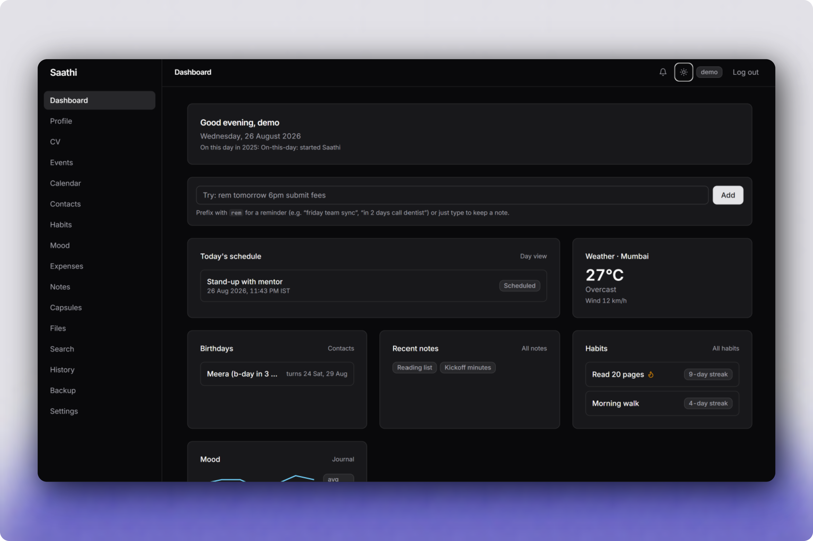

# Saathi ("Here I Am")


**Saathi ("Here I Am")** is a privacy-focused server-side rendered (SSR) virtual personal assistant web application. It unifies daily scheduling, career document generation, markdown knowledge capture, secure file repositories, habit tracking, financial expense ledgers and keyless web search into an isolated multi-user workspace.



---

## Key Features

### Profile & Dynamic CV Builder
- Captures personal details, educational background and career history.
- Automatically compiles structured profile data into downloadable **PDF** (WeasyPrint) and **DOCX** (`docxtpl`) resumes.

### Smart Scheduling & Calendar Engine
- Materialized event recurrence engine aligned with local IST timezone.
- **Natural-Language Quick-Add**: Enter events like `"rem tomorrow at 6pm team meeting"` with an instant 5-minute session Undo bar.
- **iCalendar (ICS) Feed**: Live bearer-token feed compatible with Google Calendar, Apple Calendar and Outlook.
- Background **ticker thread** and external heartbeat endpoint (`POST /tick`) with email notification dispatch.

### Security & Multi-User Isolation
- **RFC 6238 TOTP 2FA**: QR code setup with SHA-256 single-use recovery codes.
- **Brute-Force Protection**: 5-attempt sliding window IP/email lockout and session kill-switches.
- **OWASP Compliance**: Strict security headers, CSRF tokens, `nh3` HTML sanitization and full IDOR ownership defenses.

### Life Dashboard & Productivity Tools
- **Habit Tracker**: 60-cell heat grid with 7-day completion streak badges.
- **Mood Journal**: 5-point monthly mood tracker with detailed notes.
- **Expense Ledger**: Financial tracking stored as integer cents with category breakdowns.
- **Markdown Notes**: Rich markdown editor with tag filtering and trash lifecycle.
- **Keyless Web Search**: DuckDuckGo search integration (`ddgs`) with 6-hour caching and Wikipedia fallbacks.
- **File Repository**: Upload pipeline with magic-byte validation, EXIF metadata stripping, thumbnail generation and 50MB quota bounds.
- **Portable Data Backup**: Full account JSON export and import with foreign key remapping.

---

## Quick Start (Local Development)

### Prerequisites
- [Python 3.13+](https://www.python.org/)
- [uv package manager](https://docs.astral.sh/uv/)

### Installation & Execution

```powershell
git clone https://github.com/senutpal/saathi.git
cd saathi

# 2. Sync dependencies
uv sync

# 3. Seed demo data (Optional)
uv run python scripts/seed_demo.py --force

# 4. Start the server
uv run waitress-serve --host=127.0.0.1 --port=8000 wsgi:app
```

Open `http://127.0.0.1:8000` in your browser. Health check endpoint is available at `/healthz`.

---

## Email Notifications (Optional)

Reminder alerts are delivered to the in-app notification bell by default. To enable SMTP email dispatches:

1. Copy `.env.example` to `.env` and set `MAIL_ENABLED=true`.
2. Configure your SMTP settings (e.g. Gmail App Password):
   ```env
   MAIL_ENABLED=true
   MAIL_SERVER=smtp.gmail.com
   MAIL_PORT=465
   MAIL_USE_TLS=false
   MAIL_USE_SSL=true
   MAIL_USERNAME=your-email@gmail.com
   MAIL_PASSWORD=your-16-char-app-password
   ```

---

## Testing & Code Quality

Saathi includes a comprehensive automated test suite with **404 test functions** achieving **96% branch coverage**:

```powershell
# Run unit, integration and journey tests
uv run pytest

# Check code formatting & linting
uv run ruff check .
uv run ruff format --check .
```
