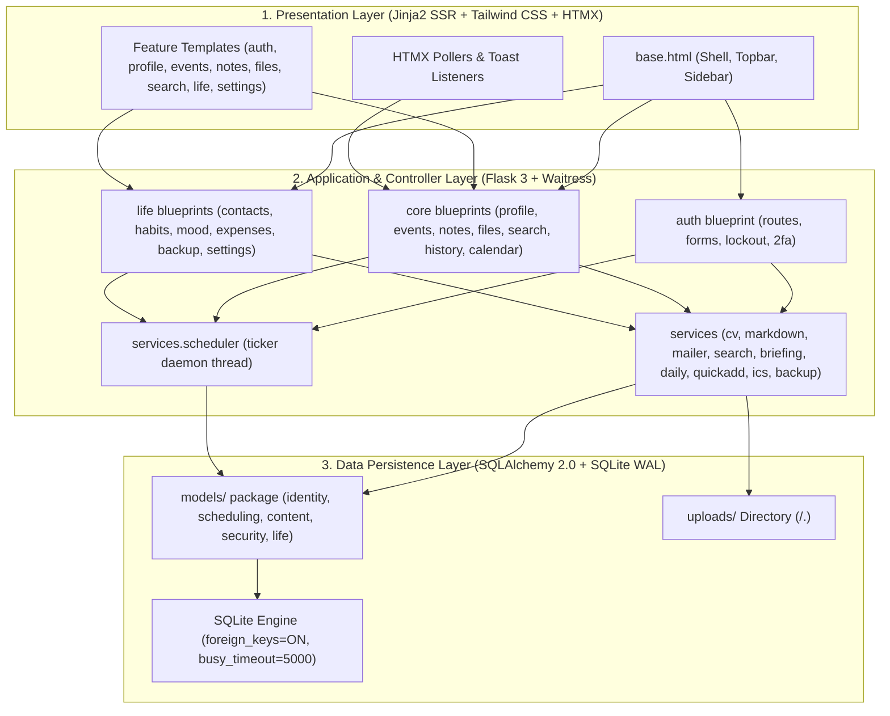

# Software Design Document (SDD) — Saathi ("Here I Am")

> **Document Version**: 1.1.0 Submission Baseline
> **System Architecture**: 3-Layer Web Architecture (Presentation, Application, Data)

---

## 1. System Architecture (3-Layer Model)



---

## 2. Complete Data Dictionary (22 Tables)

Regenerated directly from `saathi/models/` package (`identity.py`, `scheduling.py`, `content.py`, `security.py`, `life.py`).

### 2.1 Identity Module (`identity.py`)

#### Table: `users`
| Column | Type | Constraints | Description |
|---|---|---|---|
| `id` | Integer | Primary Key, Autoincrement | Unique user identifier |
| `username` | String(60) | Unique, Not Null, Index | User handle |
| `email` | String(120) | Unique, Not Null, Index | Login email address |
| `password_hash` | String(255) | Not Null | Salted PBKDF2/scrypt hash |
| `is_two_fa_enabled` | Boolean | Not Null, Default False | 2FA toggle flag |
| `two_fa_secret` | String(32) | Nullable | Base32 TOTP secret key |
| `session_invalid_before` | DateTime | Nullable | Logout-everywhere revocation timestamp |
| `digest_enabled` | Boolean | Not Null, Default True | Weekly Monday email digest opt-in |
| `digest_last_sent_at` | DateTime | Nullable | Last digest dispatch timestamp |
| `created_at` | DateTime | Not Null, Default UTC now | Registration timestamp |

#### Table: `profiles`
| Column | Type | Constraints | Description |
|---|---|---|---|
| `id` | Integer | Primary Key | Profile record ID |
| `user_id` | Integer | FK(`users.id`), Unique, Not Null | Owner user FK |
| `full_name` | String(120) | Not Null | User's displayed full name |
| `headline` | String(140) | Nullable | Professional headline |
| `date_of_birth` | Date | Nullable | Date of birth |
| `phone` | String(30) | Nullable | Contact phone number |
| `address` | String(255) | Nullable | Physical location/address |
| `skills_csv` | String(500) | Nullable | Comma-separated skills |
| `summary` | Text | Nullable | Professional bio summary |
| `public_token` | String(32) | Unique, Nullable | Public portfolio share token |
| `share_enabled` | Boolean | Not Null, Default False | Public share active toggle |

#### Table: `education_entries`
| Column | Type | Constraints | Description |
|---|---|---|---|
| `id` | Integer | Primary Key | Education entry ID |
| `user_id` | Integer | FK(`users.id`), Not Null, Index | Owner user FK |
| `institution` | String(120) | Not Null | School / University name |
| `degree` | String(120) | Not Null | Degree / Qualification |
| `field_of_study` | String(120) | Nullable | Major / Specialization |
| `start_date` | Date | Not Null | Start date |
| `end_date` | Date | Nullable | Graduation / End date |

#### Table: `work_entries`
| Column | Type | Constraints | Description |
|---|---|---|---|
| `id` | Integer | Primary Key | Work history ID |
| `user_id` | Integer | FK(`users.id`), Not Null, Index | Owner user FK |
| `company` | String(120) | Not Null | Organization name |
| `role` | String(120) | Not Null | Job title / Role |
| `description` | Text | Nullable | Key achievements & responsibilities |
| `start_date` | Date | Not Null | Employment start date |
| `end_date` | Date | Nullable | Employment end date |

---

### 2.2 Scheduling Module (`scheduling.py`)

#### Table: `events`
| Column | Type | Constraints | Description |
|---|---|---|---|
| `id` | Integer | Primary Key | Event ID |
| `user_id` | Integer | FK(`users.id`), Not Null, Index | Owner user FK |
| `title` | String(200) | Not Null | Reminder / Event title |
| `description` | Text | Nullable | Detailed notes |
| `event_at` | DateTime | Not Null, Index | UTC scheduled firing time |
| `status` | String(20) | Not Null, Default 'scheduled' | `scheduled` \| `fired` \| `fired_late` \| `missed` \| `cancelled` |
| `repeat_rule` | String(20) | Not Null, Default 'none' | `none` \| `daily` \| `weekly` \| `monthly` |
| `fired_at` | DateTime | Nullable | Actual ticker firing timestamp |
| `created_at` | DateTime | Not Null, Default UTC now | Creation timestamp |

#### Table: `notifications`
| Column | Type | Constraints | Description |
|---|---|---|---|
| `id` | Integer | Primary Key | Notification ID |
| `user_id` | Integer | FK(`users.id`), Not Null, Index | Target user FK |
| `title` | String(120) | Not Null | Alert header |
| `body` | Text | Nullable | Notification body message |
| `read_at` | DateTime | Nullable, Index | Timestamp when user marked read |
| `created_at` | DateTime | Not Null, Default UTC now | Creation timestamp |

#### Table: `capsule_messages`
| Column | Type | Constraints | Description |
|---|---|---|---|
| `id` | Integer | Primary Key | Time capsule ID |
| `user_id` | Integer | FK(`users.id`), Not Null, Index | Owner user FK |
| `title` | String(120) | Not Null | Capsule title |
| `body` | Text | Not Null | Sealed message payload |
| `unlock_at` | DateTime | Not Null, Index | Future unlock datetime |
| `status` | String(20) | Not Null, Default 'sealed' | `sealed` \| `revealed` |
| `created_at` | DateTime | Not Null, Default UTC now | Sealing timestamp |

---

### 2.3 Content Module (`content.py`)

#### Table: `notes`
| Column | Type | Constraints | Description |
|---|---|---|---|
| `id` | Integer | Primary Key | Note ID |
| `user_id` | Integer | FK(`users.id`), Not Null, Index | Owner user FK |
| `event_id` | Integer | FK(`events.id`), Nullable | Optional linked Event FK |
| `title` | String(140) | Not Null | Note title |
| `content` | Text | Not Null | Markdown body content |
| `created_at` | DateTime | Not Null, Default UTC now | Creation timestamp |
| `updated_at` | DateTime | Not Null, Default UTC now | Last modification timestamp |
| `deleted_at` | DateTime | Nullable, Index | Soft-deletion timestamp (Trash) |

#### Table: `tags`
| Column | Type | Constraints | Description |
|---|---|---|---|
| `id` | Integer | Primary Key | Tag ID |
| `user_id` | Integer | FK(`users.id`), Not Null | Owner user FK |
| `name` | String(40) | Not Null | Tag slug name |

#### Table: `note_tags` (Junction Table)
| Column | Type | Constraints | Description |
|---|---|---|---|
| `note_id` | Integer | FK(`notes.id`), PK | Note FK |
| `tag_id` | Integer | FK(`tags.id`), PK | Tag FK |

#### Table: `uploads`
| Column | Type | Constraints | Description |
|---|---|---|---|
| `id` | Integer | Primary Key | Upload ID |
| `user_id` | Integer | FK(`users.id`), Not Null, Index | Owner user FK |
| `original_filename` | String(255) | Not Null | User's upload filename |
| `stored_filename` | String(255) | Unique, Not Null | Disk UUID filename (`uuid.ext`) |
| `mime_type` | String(100) | Not Null | Validated MIME type |
| `size_bytes` | Integer | Not Null | File size in bytes |
| `is_image` | Boolean | Not Null, Default False | Image thumbnail availability flag |
| `uploaded_at` | DateTime | Not Null, Default UTC now | Upload timestamp |

#### Table: `search_cache`
| Column | Type | Constraints | Description |
|---|---|---|---|
| `query_hash` | String(64) | Primary Key | SHA256 of query text |
| `query_text` | String(200) | Not Null | Original query text |
| `source` | String(20) | Not Null | `ddgs` \| `wikipedia` |
| `results_json` | Text | Not Null | Cached JSON payload |
| `fetched_at` | DateTime | Not Null | Retrieval timestamp (6h TTL) |

#### Table: `weather_cache`
| Column | Type | Constraints | Description |
|---|---|---|---|
| `city_key` | String(80) | Primary Key | Normalized city key |
| `weather_json` | Text | Not Null | Cached Open-Meteo payload |
| `fetched_at` | DateTime | Not Null | Retrieval timestamp (30m TTL) |

#### Table: `activity_logs`
| Column | Type | Constraints | Description |
|---|---|---|---|
| `id` | Integer | Primary Key | Audit row ID |
| `user_id` | Integer | FK(`users.id`), Not Null, Index | Owner user FK |
| `event_id` | Integer | FK(`events.id`), Nullable | Optional linked Event FK |
| `activity_type` | String(30) | Not Null, Index | Action verb slug |
| `title` | String(120) | Not Null | Log action title summary |
| `details` | String(255) | Nullable | Secondary contextual details |
| `occurred_at` | DateTime | Not Null, Default UTC now | Occurrence timestamp |

---

### 2.4 Security Module (`security.py`)

#### Table: `login_attempts`
| Column | Type | Constraints | Description |
|---|---|---|---|
| `id` | Integer | Primary Key | Attempt ID |
| `email_hash` | String(64) | Not Null, Index | SHA256 of target email |
| `ip_address` | String(45) | Not Null | Client IP address |
| `attempted_at` | DateTime | Not Null, Index | Attempt timestamp |
| `was_successful` | Boolean | Not Null | Success/Failure flag |

#### Table: `login_records`
| Column | Type | Constraints | Description |
|---|---|---|---|
| `id` | Integer | Primary Key | Record ID |
| `user_id` | Integer | FK(`users.id`), Not Null, Index | User FK |
| `ip_address` | String(45) | Not Null | Sign-in IP address |
| `user_agent` | String(255) | Nullable | Client browser User-Agent |
| `logged_in_at` | DateTime | Not Null, Default UTC now | Login timestamp |

#### Table: `backup_codes`
| Column | Type | Constraints | Description |
|---|---|---|---|
| `id` | Integer | Primary Key | Backup code ID |
| `user_id` | Integer | FK(`users.id`), Not Null, Index | User FK |
| `code_hash` | String(64) | Not Null | SHA256 of 2FA backup token |
| `used_at` | DateTime | Nullable | Single-use consumption stamp |

---

### 2.5 Life Module (`life.py`)

#### Table: `contacts`
| Column | Type | Constraints | Description |
|---|---|---|---|
| `id` | Integer | Primary Key | Contact ID |
| `user_id` | Integer | FK(`users.id`), Not Null, Index | Owner user FK |
| `name` | String(120) | Not Null | Contact name |
| `email` | String(120) | Nullable | Contact email |
| `phone` | String(30) | Nullable | Contact phone number |
| `birthday` | Date | Nullable | Contact birth date |
| `created_at` | DateTime | Not Null, Default UTC now | Creation timestamp |

#### Table: `habits`
| Column | Type | Constraints | Description |
|---|---|---|---|
| `id` | Integer | Primary Key | Habit ID |
| `user_id` | Integer | FK(`users.id`), Not Null, Index | Owner user FK |
| `title` | String(120) | Not Null | Habit title |
| `color` | String(20) | Not Null, Default 'emerald' | UI grid color key |
| `created_at` | DateTime | Not Null, Default UTC now | Creation timestamp |

#### Table: `habit_logs`
| Column | Type | Constraints | Description |
|---|---|---|---|
| `id` | Integer | Primary Key | Habit completion log ID |
| `habit_id` | Integer | FK(`habits.id`), Not Null | Parent habit FK |
| `logged_date` | Date | Not Null, Index | Day of completion |

#### Table: `mood_entries`
| Column | Type | Constraints | Description |
|---|---|---|---|
| `id` | Integer | Primary Key | Mood entry ID |
| `user_id` | Integer | FK(`users.id`), Not Null, Index | Owner user FK |
| `mood_date` | Date | Not Null, Index | Date of mood log |
| `score` | Integer | Not Null, CHECK(1..5) | 1=Terrible, 5=Great |
| `note` | String(255) | Nullable | Optional journal note |

#### Table: `expenses`
| Column | Type | Constraints | Description |
|---|---|---|---|
| `id` | Integer | Primary Key | Expense record ID |
| `user_id` | Integer | FK(`users.id`), Not Null, Index | Owner user FK |
| `amount_cents` | Integer | Not Null, CHECK(>=0) | Financial amount in cents |
| `category` | String(40) | Not Null | Category classification |
| `description` | String(140) | Nullable | Item/transaction summary |
| `expense_date` | Date | Not Null, Index | Transaction date |

---

## 3. Database Normalization Justification (3NF)

1. **First Normal Form (1NF)**: All attributes contain atomic scalar values (integers, strings, dates). Multivalued attributes like tags, habit logs, or profile skills are extracted into separate relational tables (`tags`/`note_tags`, `habit_logs`) or normalized collections.
2. **Second Normal Form (2NF)**: Every non-key column depends on the full primary key of its table. Foreign key relationships (`user_id`, `event_id`, `habit_id`) cleanly isolate dependent entity records.
3. **Third Normal Form (3NF)**: Transitive dependencies are removed. User email and credentials reside strictly in `users`. Profile details reside in `profiles`. Expense totals and category aggregates are computed via SQL aggregation functions (`func.sum`, `func.strftime`) rather than storing redundant derived summary fields.

---

## 4. Decision Table, Decision Tree & Structured English

### 4.1 Reminder Execution Logic (Decision Table)

| Condition / Action Rules | R1 | R2 | R3 | R4 |
|---|---|---|---|---|
| **C1**: `event_at <= current_utc_time` | F | T | T | T |
| **C2**: `status == 'scheduled'` | – | F | T | T |
| **C3**: `age(event_at) <= 24h` grace period | – | – | T | F |
| **A1**: Set `status = 'fired_late'`, stamp `fired_at` | | | X | |
| **A2**: Set `status = 'missed'` | | | | X |
| **A3**: Insert `Notification` & trigger SMTP dispatch | | | X | |
| **A4**: Instantiate next recurrence row if `repeat_rule != 'none'` | | | X | |

### 4.2 Structured English (Ticker Processing)

```
FOR EACH event IN events WHERE event_at <= now_utc() AND status = 'scheduled':
    BEGIN TRANSACTION
    IF age_in_hours(event.event_at) <= 24 THEN
        UPDATE event SET status = 'fired_late', fired_at = now_utc()
        INSERT INTO notifications (user_id, title, body) VALUES (event.user_id, event.title, ...)
        INSERT INTO activity_logs (user_id, activity_type, title) VALUES (event.user_id, 'event_fired', ...)
        IF event.repeat_rule != 'none' THEN
            INSERT INTO events (user_id, title, event_at, repeat_rule, status)
            VALUES (event.user_id, event.title, calculate_next_occurrence(event.event_at, event.repeat_rule), event.repeat_rule, 'scheduled')
        END IF
    ELSE
        UPDATE event SET status = 'missed'
    END IF
    COMMIT TRANSACTION
END FOR
```

### 4.3 CV Export Decision Tree

```
[User Requests CV Export]
   |
   +-- [Profile Exists?]
   |      |-- No  --> Render 409 Conflict (cv_empty.html)
   |      |-- Yes --> [Has Education OR Work Entries?]
   |                     |-- No  --> Render 409 Conflict (cv_empty.html)
   |                     |-- Yes --> [Format Requested]
   |                                    |-- PDF  --> Render HTML via WeasyPrint -> Download .pdf
   |                                    |-- DOCX --> Fill template via docxtpl -> Download .docx
```
