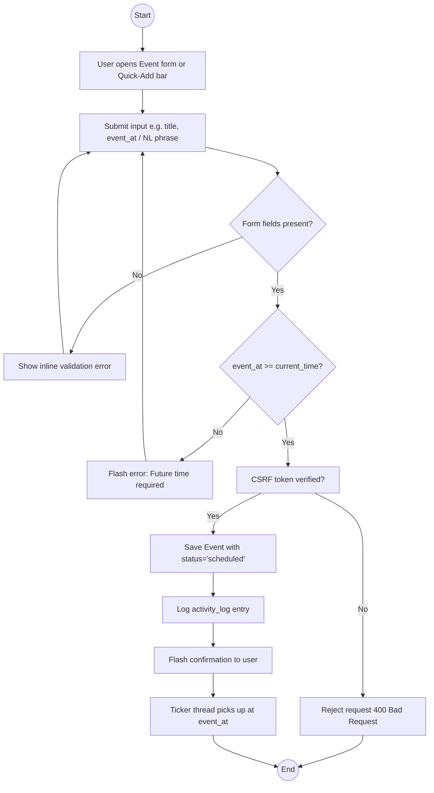
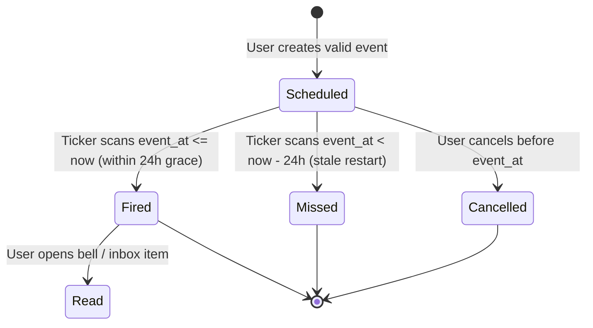
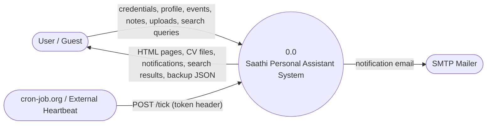
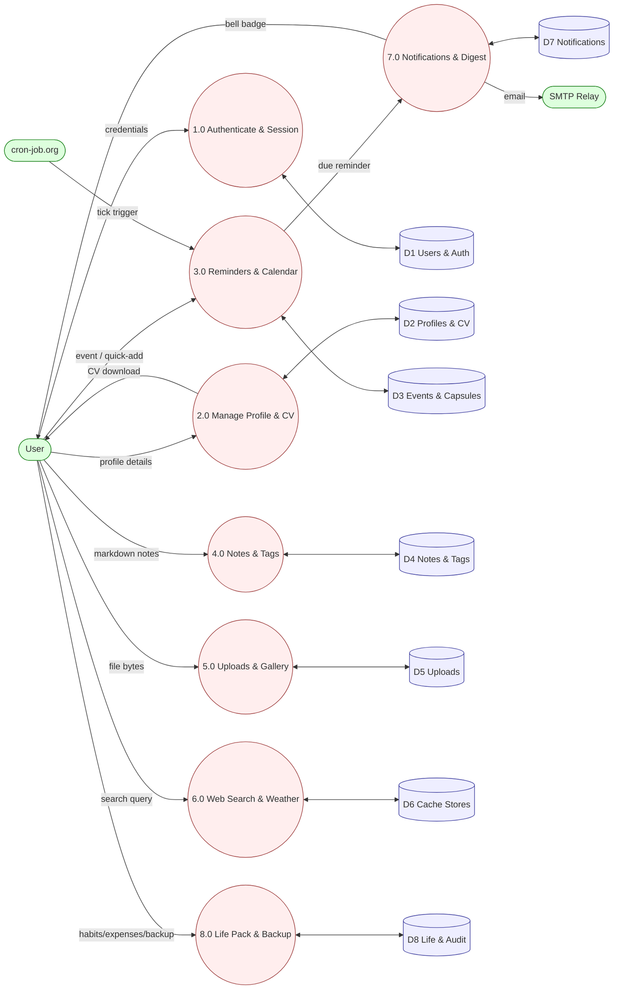
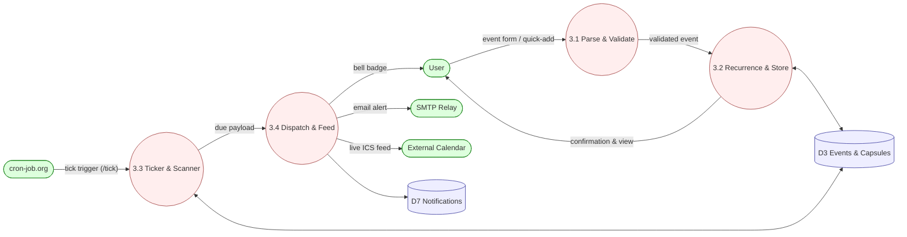
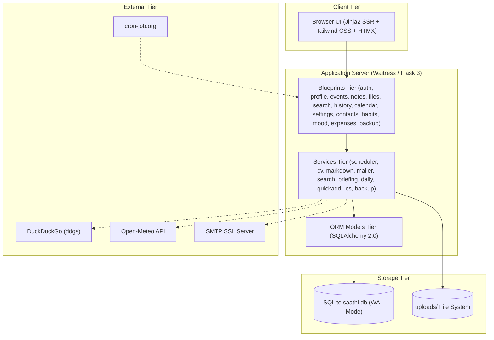
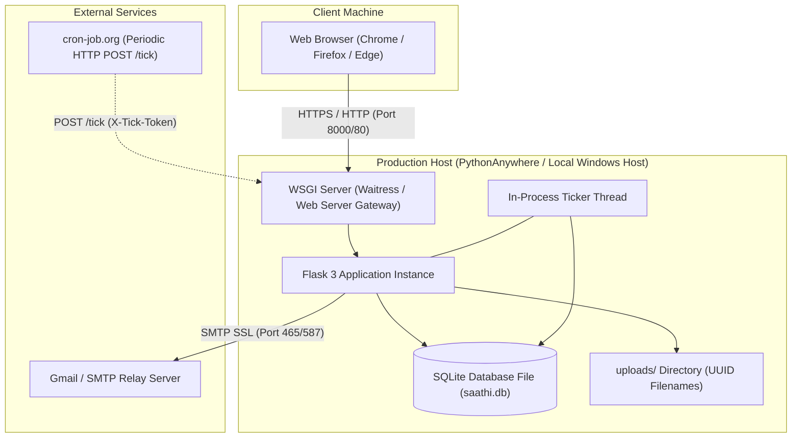
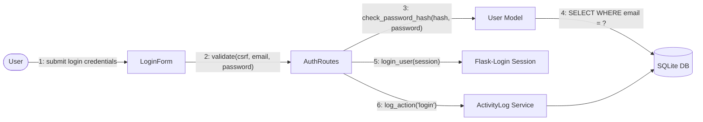
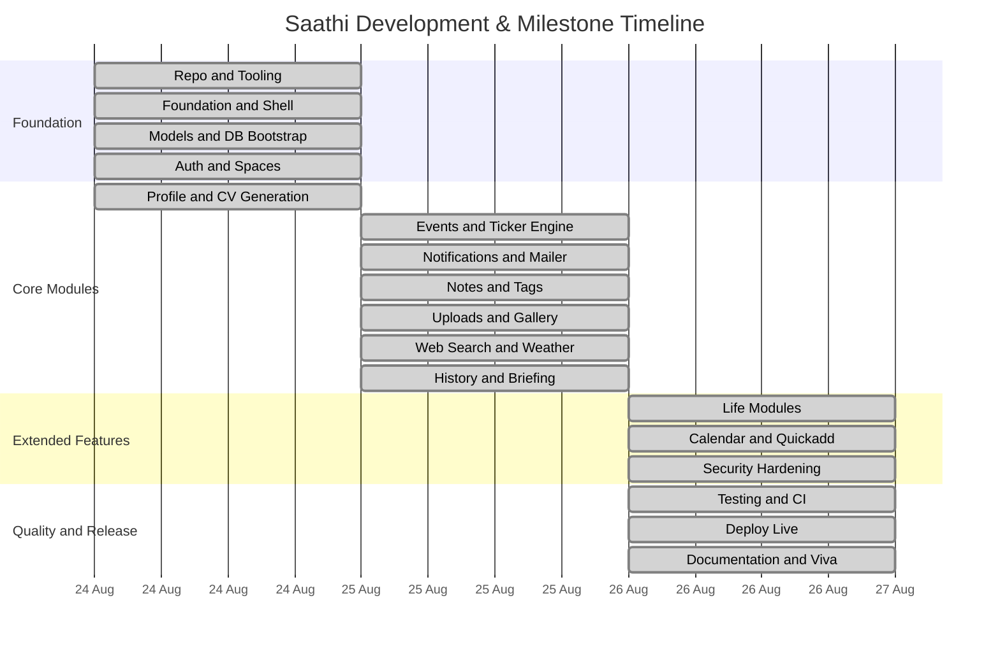

# Behavioral & Structural Diagrams — Saathi ("Here I Am")

## 1. Activity Diagram (Add Reminder / Quick-Add Path)

## 2. Event Lifecycle State Chart

## 3. Data Flow Diagrams (DFD)

### Level 0 Context DFD

### Level 1 Decomposed DFD

### Level 2 Decomposed DFD (Process 3.0: Smart Reminder Engine)

## 4. Component Diagram

## 5. Deployment Diagram

## 6. Collaboration Diagram (Login Interaction)

## 7. PERT Network Diagram & Milestone Timeline

