# Content Diagram (Context Diagram) — Saathi ("Here I Am")

> A **Context Diagram** (also called a Content Diagram or Level-0 DFD) shows the entire system as a single process and identifies all external entities that interact with it, along with the data flows between them.

---

## System Context Diagram

```mermaid
flowchart TB
    %% External Entities
    GUEST(["👤 Guest User<br/>(Unregistered)"]):::actor
    USER(["👤 Registered User"]):::actor
    CRON(["⏰ cron-job.org<br/>(External Heartbeat)"]):::ext
    SMTP(["✉️ SMTP Mail Server<br/>(Gmail / Relay)"]):::ext
    DDG(["🔍 DuckDuckGo API<br/>(ddgs Search)"]):::ext
    METEO(["🌦️ Open-Meteo API<br/>(Weather Data)"]):::ext
    GCAL(["📅 External Calendars<br/>(Google / Apple / Outlook)"]):::ext

    %% Central System
    SAATHI(("🤝 SAATHI<br/>Personal Assistant<br/>System")):::system

    %% Guest → System flows
    GUEST -->|"registration form<br/>(username, email, password)"| SAATHI
    SAATHI -->|"registration confirmation<br/>login page"| GUEST

    %% User → System flows (Inputs)
    USER -->|"login credentials<br/>(email, password, TOTP)"| SAATHI
    USER -->|"profile data<br/>(name, DOB, phone, edu, work)"| SAATHI
    USER -->|"event/reminder details<br/>(title, date-time, repeat rule)"| SAATHI
    USER -->|"notes & tags<br/>(markdown content, tag names)"| SAATHI
    USER -->|"file uploads<br/>(documents, images)"| SAATHI
    USER -->|"search queries"| SAATHI
    USER -->|"life data<br/>(habits, moods, expenses, contacts)"| SAATHI
    USER -->|"capsule messages<br/>(sealed letters for future)"| SAATHI

    %% System → User flows (Outputs)
    SAATHI -->|"dashboard & HTML pages"| USER
    SAATHI -->|"CV documents<br/>(PDF / DOCX)"| USER
    SAATHI -->|"notifications<br/>(bell badge, toast alerts)"| USER
    SAATHI -->|"search results<br/>(web + weather data)"| USER
    SAATHI -->|"calendar views<br/>(month/week/day)"| USER
    SAATHI -->|"downloaded files"| USER
    SAATHI -->|"activity history<br/>& audit logs"| USER
    SAATHI -->|"JSON backup export"| USER

    %% External Service flows
    CRON -->|"POST /tick<br/>(X-Tick-Token header)"| SAATHI
    SAATHI -->|"notification emails<br/>(event alerts, digests)"| SMTP
    SAATHI -->|"search API requests"| DDG
    DDG -->|"search results JSON"| SAATHI
    SAATHI -->|"weather API requests"| METEO
    METEO -->|"weather forecast JSON"| SAATHI
    SAATHI -->|"iCalendar .ics feed"| GCAL

    %% Styling
    classDef actor fill:#E3F2FD,stroke:#1565C0,stroke-width:2px,color:#0D47A1
    classDef ext fill:#FFF3E0,stroke:#E65100,stroke-width:2px,color:#BF360C
    classDef system fill:#E8F5E9,stroke:#2E7D32,stroke-width:3px,color:#1B5E20,font-size:16px
```

---

## External Entities Summary

| Entity | Type | Data Exchanged |
|---|---|---|
| **Guest User** | Human Actor | Registration form data ↔ Confirmation pages |
| **Registered User** | Human Actor (Primary) | Profile, events, notes, files, queries ↔ Pages, CVs, notifications, search results, backups |
| **cron-job.org** | External System | Periodic HTTP POST tick trigger → fires due reminders |
| **SMTP Mail Server** | External System | Outbound notification/digest emails |
| **DuckDuckGo API** | External System | Search queries → ranked search results |
| **Open-Meteo API** | External System | Location queries → weather forecast data |
| **External Calendars** | External System | Subscribes to live `.ics` iCalendar feed |

---

## System Boundary Description

The **Saathi Personal Assistant System** encompasses:

1. **Authentication & Authorization** — Registration, login, 2FA TOTP, session management
2. **Profile & CV Management** — Personal data, education, work history, dual-format CV generation
3. **Scheduling & Reminders** — Event creation, calendar views, ticker-based firing, recurring events
4. **Notifications Engine** — In-app bell notifications, email dispatch, weekly digest
5. **Content Management** — Markdown notes with tags, secure file uploads with quotas
6. **Web Search & Weather** — DuckDuckGo integration with cache, Open-Meteo weather lookups
7. **Life Management** — Habit tracking, mood journal, expense ledger, contacts, time capsules
8. **Data Portability** — Full JSON backup export/import, public profile sharing, iCal feed
