# Content Diagram (Context Diagram) - Saathi (Here I Am)

A context diagram shows the full system as one process and all external entities that exchange data with it.

## 1. System Context Diagram

```mermaid
flowchart TB
    GUEST[Guest User]
    USER[Registered User]
    CRON[Cron Service]
    SMTP[Mail Server]
    SEARCH[Search API]
    WEATHER[Weather API]
    CAL[External Calendars]
    SAATHI((Saathi System))

    GUEST -->|registration data| SAATHI
    SAATHI -->|confirmation and login page| GUEST

    USER -->|login credentials| SAATHI
    USER -->|profile and education and work data| SAATHI
    USER -->|event and reminder details| SAATHI
    USER -->|notes and tags| SAATHI
    USER -->|file uploads| SAATHI
    USER -->|search queries| SAATHI
    USER -->|habits and moods and expenses and contacts| SAATHI
    USER -->|capsule messages| SAATHI

    SAATHI -->|pages and dashboard| USER
    SAATHI -->|CV files in PDF and DOCX| USER
    SAATHI -->|notifications| USER
    SAATHI -->|search and weather results| USER
    SAATHI -->|calendar views| USER
    SAATHI -->|file downloads| USER
    SAATHI -->|activity history| USER
    SAATHI -->|backup export| USER

    CRON -->|tick request| SAATHI
    SAATHI -->|alert and digest mail| SMTP
    SAATHI -->|search request| SEARCH
    SEARCH -->|search results| SAATHI
    SAATHI -->|weather request| WEATHER
    WEATHER -->|weather results| SAATHI
    SAATHI -->|calendar feed| CAL
```

## 2. External Entities

| Entity | Type | Data Exchanged |
|---|---|---|
| Guest User | Human | Registration data in, confirmation out |
| Registered User | Human | Profile, events, notes, files, and queries in. Pages, CV files, notifications, results, and backups out |
| Cron Service | External system | Periodic tick request to fire due reminders |
| Mail Server | External system | Outgoing alert and digest mail |
| Search API | External system | Query out, ranked results in |
| Weather API | External system | Location out, forecast in |
| External Calendars | External system | Calendar feed out for subscription |

## 3. System Boundary

The Saathi system includes:

1. Authentication: registration, login, two factor check, session control.
2. Profile and CV: personal data, education, work history, CV generation.
3. Scheduling: event entry, calendar views, repeat rules, reminder firing.
4. Notifications: in app alerts, mail alerts, weekly digest.
5. Content: notes with tags, file uploads with quota control.
6. Search and weather: web search with cache, weather lookup with cache.
7. Life records: habits, moods, expenses, contacts, time capsules.
8. Data portability: backup export and import, profile sharing, calendar feed.
