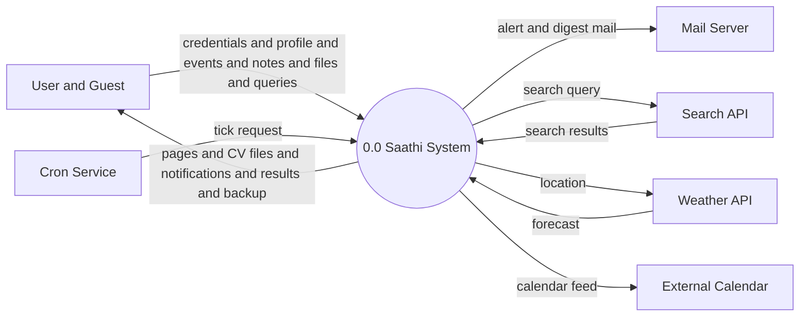
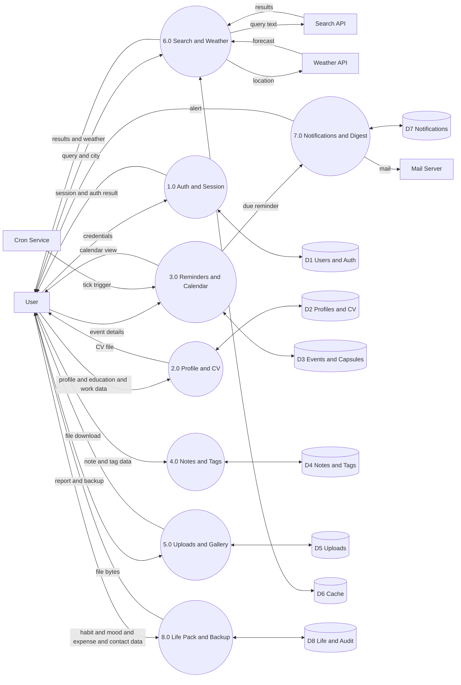
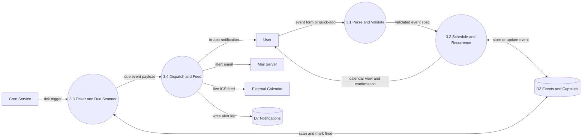
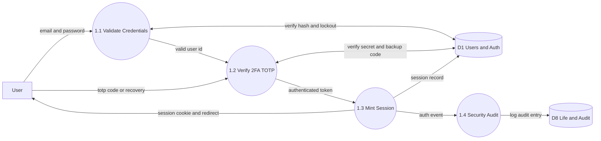
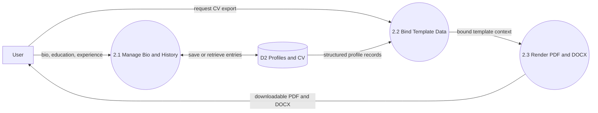
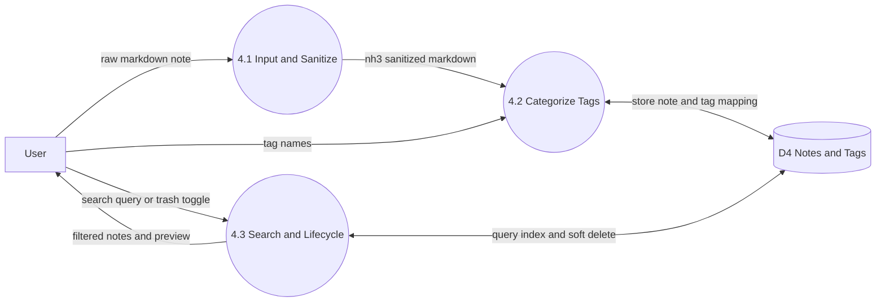
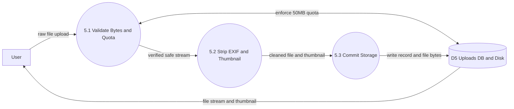
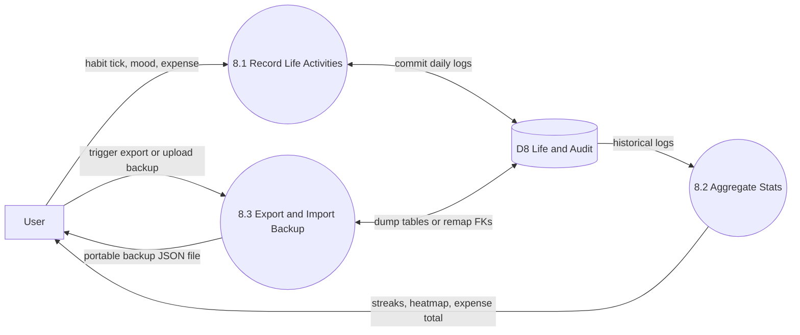

# Data Flow Diagram - Saathi (Here I Am)

Data flow diagrams show how data moves through the system. Notation used: circle for process, rectangle for external entity, open rectangle for data store, arrow for data flow.

## 1. Level 0 - Context Diagram

The full system is shown as one process.

## 2. Level 1 - System Internals

Process 0.0 is divided into 8 sub processes with data stores.

## 3. Level 2 - Detailed Subsystems

Level 2 decomposes high-level Level 1 processes into discrete, auditable sub-processes. Below are the clean, short Level 2 DFDs for Saathi's subsystems, beginning with the primary core engine: **Process 3.0 (Smart Reminder & Scheduling Engine)**.

### 3.1 Primary Core Engine: Process 3.0 (Smart Reminders & Scheduling Engine)

Decomposes Process 3.0 into 4 concise sub-processes handling event ingestion, recurrence, background scanning, and multi-channel dispatch.

### 3.2 Security Engine: Process 1.0 (Authentication & Access Control)

Decomposes Process 1.0 into 4 concise sub-processes for brute-force defense, TOTP verification, session issuance, and audit tracking.

### 3.3 Career Engine: Process 2.0 (Profile & Dynamic CV Builder)

Decomposes Process 2.0 into 3 sub-processes covering bio entry, structured template binding, and binary document rendering.

### 3.4 Knowledge Engine: Process 4.0 (Notes & Tagging System)

Decomposes Process 4.0 into 3 sub-processes covering markdown sanitization, tag categorization, and lifecycle trash management.

### 3.5 Storage Engine: Process 5.0 (Uploads & Repository)

Decomposes Process 5.0 into 3 sub-processes handling magic-byte MIME checking, EXIF sanitization with thumbnail generation, and disk storage.

### 3.6 Productivity Engine: Process 8.0 (Life Pack & Backup Engine)

Decomposes Process 8.0 into 3 sub-processes for habit/mood/expense tracking, statistical analytics, and JSON export/import with foreign key remapping.

## 4. Data Store Mapping

| Store | Tables | Content |
|---|---|---|
| D1 Users and Auth | users, login_attempts, backup_codes, logins | Credentials, login control, sessions |
| D2 Profiles and CV | profiles, education_entries, work_entries | Personal data and CV source |
| D3 Events and Capsules | events, capsule_messages | Reminders and sealed letters |
| D4 Notes and Tags | notes, tags, note_tags | Notes with many to many tags |
| D5 Uploads | uploads plus files on disk | Stored files and thumbnails |
| D6 Cache | search_cache, weather_cache | Short term search and weather results |
| D7 Notifications | notifications | Alerts and mail records |
| D8 Life and Audit | habits, habit_logs, moods, expenses, contacts, activity_log | Life records and audit trail |

## 5. Process Descriptions

### 5.1 Level 1 Processes

| Process | Input | Output | Description |
|---|---|---|---|
| 1.0 Auth and Session | Email, password, TOTP code | Session, auth result | Registration, login, two factor check, lockout control |
| 2.0 Profile and CV | Profile and education and work data | CV file, profile pages | Stores personal data, builds CV |
| 3.0 Reminders and Calendar | Event data, tick trigger | Calendar views, due reminders | Creates events, applies repeat rules, fires due items |
| 4.0 Notes and Tags | Note text, tag names | Stored notes, filtered views | Note entry with tags and trash control |
| 5.0 Uploads and Gallery | File bytes | Stored files, downloads | Type check, quota check, safe storage |
| 6.0 Search and Weather | Query, city name | Results, forecast | External lookup with local cache |
| 7.0 Notifications and Digest | Due reminder data | Mail, in app alerts | Alert records, mail dispatch, weekly digest |
| 8.0 Life Pack and Backup | Habit and expense and mood data | Reports, backup file | Life tracking plus export and import |

### 5.2 Level 2 Decomposed Sub-Processes

| Sub-Process | Input | Output | Description |
|---|---|---|---|
| 3.1 Parse and Validate | Raw event fields / Quick-Add string | Validated event spec | Natural language parser, IST timezone normalization, future timestamp validation |
| 3.2 Schedule and Recurrence | Validated event spec | Stored event, calendar view | Materializes repeat rules (daily/weekly/monthly), commits to D3 |
| 3.3 Ticker and Due Scanner | Tick trigger (POST /tick or worker) | Due event payload | Scans D3 within 24-hour grace window, marks event as fired |
| 3.4 Dispatch and Feed | Due event payload, ICS request | In-app alert, email, ICS feed | Writes to D7, sends SMTP email, updates notification bell, serves calendar feed |
| 1.1 Validate Credentials | Email, password, client IP | Valid user identity | Sliding-window lockout check, PBKDF2/scrypt password hash verification |
| 1.2 Verify 2FA TOTP | 6-digit TOTP code / recovery code | Verified auth token | RFC 6238 time-step check, single-use recovery code consumption |
| 1.3 Mint Session | Verified auth token | Session cookie, redirect | Generates secure session cookie, registers session in D1 |
| 1.4 Security Audit | Auth event metadata | Audit log record | Records login timestamp, IP address, and security status in D8 |
| 2.1 Manage Bio and History | Bio, education, experience | Profile records | CRUD operations on personal, education, and career entries |
| 2.2 Bind Template Data | Profile records | Bound context | Maps database entities to Jinja2 / docxtpl template models |
| 2.3 Render PDF and DOCX | Bound context | Exported files | Compiles resume files using WeasyPrint (PDF) and docxtpl (DOCX) |
| 4.1 Input and Sanitize | Raw markdown text | Safe markdown | Cleans HTML tags using `nh3` to prevent XSS attacks |
| 4.2 Categorize Tags | Note entity, tag labels | Tagged notes | Normalizes tags, maintains many-to-many junction records in D4 |
| 4.3 Search and Lifecycle | Query text, delete flag | Filtered views | Provides title/body search, manages soft deletion and trash bin |
| 5.1 Validate Bytes and Quota | File stream | Validated stream | Uses `puremagic` for MIME sniffing and enforces the 50MB quota |
| 5.2 Strip EXIF and Thumbnail | Validated image stream | Sanitized image | Strips GPS/camera metadata with Pillow, generates 120px thumbnails |
| 5.3 Commit Storage | Clean file bytes, metadata | Storage record | Writes UUID-named file to disk directory and creates DB row in D5 |
| 8.1 Record Life Activities | Daily tracking inputs | Tracking records | Logs habit check-ins, 5-point mood ratings, and expense amounts |
| 8.2 Aggregate Stats | Historical records | Dashboard metrics | Calculates 7-day habit streaks, 60-day heat grid, and category sums |
| 8.3 Export and Import Backup | Account tables / JSON backup | Backup file / restored DB | Full JSON serialization and deserialization with foreign key remapping |
