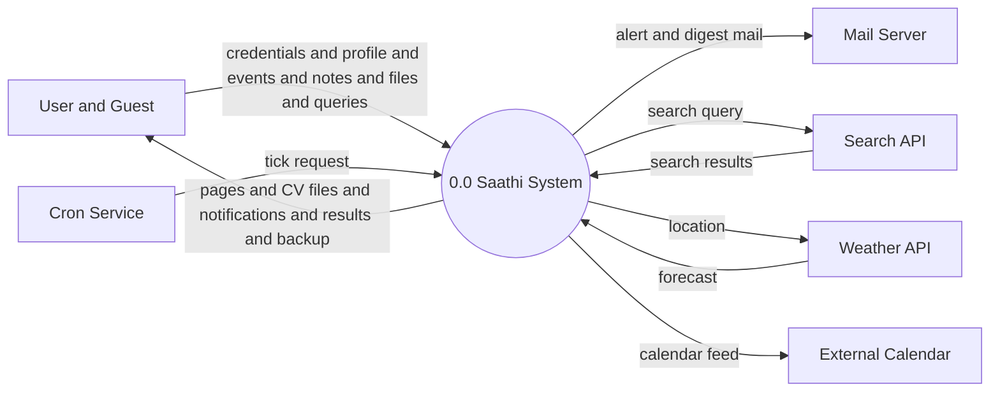
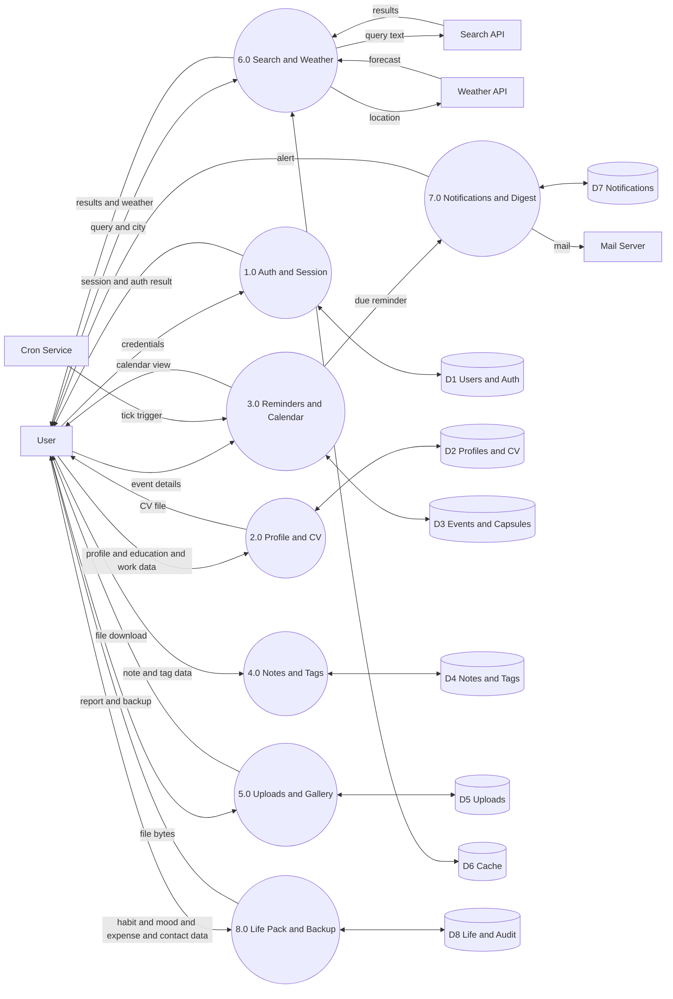

# Data Flow Diagram - Saathi (Here I Am)

Data flow diagrams show how data moves through the system. Notation used: circle for process, rectangle for external entity, open rectangle for data store, arrow for data flow.

## 1. Level 0 - Context Diagram

The full system is shown as one process.

## 2. Level 1 - System Internals

Process 0.0 is divided into 8 sub processes with data stores.

## 3. Data Store Mapping

| Store | Tables | Content |
|---|---|---|
| D1 Users and Auth | users, login_attempts, backup_codes, logins | Credentials, login control, sessions |
| D2 Profiles and CV | profiles, education_entries, work_entries | Personal data and CV source |
| D3 Events and Capsules | events, capsule_messages | Reminders and sealed letters |
| D4 Notes and Tags | notes, tags, note_tags | Notes with many to many tags |
| D5 Uploads | uploads plus files on disk | Stored files and thumbnails |
| D6 Cache | search_cache, weather_cache | Short term search and weather results |
| D7 Notifications | notifications | Alerts and mail records |
| D8 Life and Audit | habits, habit_logs, moods, expenses, contacts, activity_log | Life records and audit trail |

## 4. Process Descriptions

| Process | Input | Output | Description |
|---|---|---|---|
| 1.0 Auth and Session | Email, password, TOTP code | Session, auth result | Registration, login, two factor check, lockout control |
| 2.0 Profile and CV | Profile and education and work data | CV file, profile pages | Stores personal data, builds CV |
| 3.0 Reminders and Calendar | Event data, tick trigger | Calendar views, due reminders | Creates events, applies repeat rules, fires due items |
| 4.0 Notes and Tags | Note text, tag names | Stored notes, filtered views | Note entry with tags and trash control |
| 5.0 Uploads and Gallery | File bytes | Stored files, downloads | Type check, quota check, safe storage |
| 6.0 Search and Weather | Query, city name | Results, forecast | External lookup with local cache |
| 7.0 Notifications and Digest | Due reminder data | Mail, in app alerts | Alert records, mail dispatch, weekly digest |
| 8.0 Life Pack and Backup | Habit and expense and mood data | Reports, backup file | Life tracking plus export and import |
