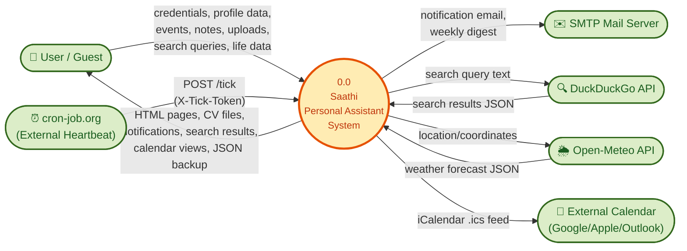
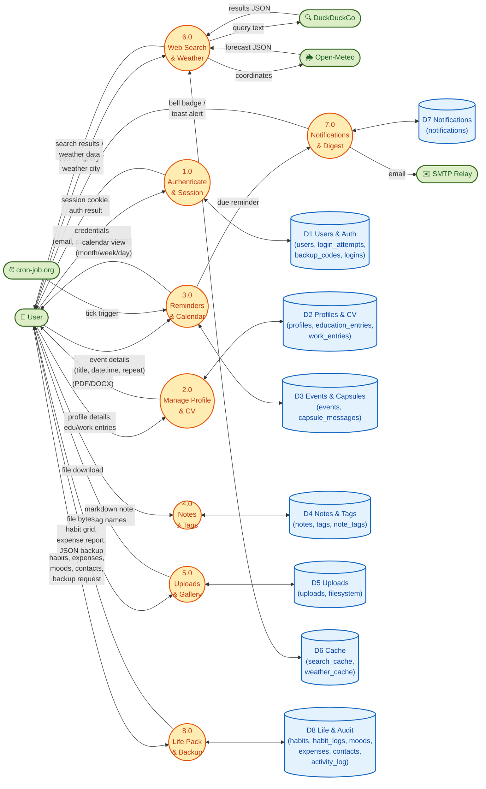

# Data Flow Diagram (DFD) — Saathi ("Here I Am")

> Data Flow Diagrams illustrate how data moves through the system. They use **Yourdon/DeMarco** notation:
> - **Circles (⭕)** = Processes (transform data)
> - **Rectangles (▭)** = External Entities (sources/sinks outside the system)
> - **Open-ended Rectangles (⊏)** = Data Stores (where data rests)
> - **Arrows (→)** = Data Flows (named pipelines carrying data)

---

## Level 0 — Context Diagram (Entire System as ONE Process)

> Shows Saathi as a single black-box process interacting with all external entities.

---

## Level 1 — Decomposed DFD (System Internals)

> Breaks down process **0.0** into 8 numbered sub-processes with their interconnections and data stores.

---

## Data Store ↔ Database Table Mapping

| Data Store | Physical Tables | Description |
|---|---|---|
| **D1** Users & Auth | `users`, `login_attempts`, `backup_codes`, `logins` | User credentials, 2FA, session security |
| **D2** Profiles & CV | `profiles`, `education_entries`, `work_entries` | Personal data, education history, work experience |
| **D3** Events & Capsules | `events`, `capsule_messages` | Reminders, recurring events, time capsules |
| **D4** Notes & Tags | `notes`, `tags`, `note_tags` | Markdown notes with M:N tag categorization |
| **D5** Uploads | `uploads` + filesystem (`uploads/` directory) | Uploaded files with UUID storage |
| **D6** Cache | `search_cache`, `weather_cache` | TTL caches for web search & weather |
| **D7** Notifications | `notifications` | Bell alerts & email dispatch records |
| **D8** Life & Audit | `habits`, `habit_logs`, `moods`, `expenses`, `contacts`, `activity_log` | Life tracking & immutable audit trail |

---

## Process Descriptions

| Process | Input | Output | Description |
|---|---|---|---|
| **1.0** Authenticate & Session | Credentials (email, password, TOTP code) | Session cookie, auth result | Validates user identity, handles registration, login, 2FA, brute-force protection |
| **2.0** Manage Profile & CV | Profile form data, edu/work entries | CV document (PDF/DOCX), profile pages | Stores personal info, generates formatted resumes |
| **3.0** Reminders & Calendar | Event details, tick triggers | Calendar views, due reminders | Creates/manages events, handles recurring rules, ticker-based firing |
| **4.0** Notes & Tags | Markdown text, tag names | Rendered notes, tag-filtered views | CRUD for notes with M:N tag relationships, soft-delete trash |
| **5.0** Uploads & Gallery | File bytes (documents, images) | File downloads, thumbnail gallery | Validates MIME types, strips EXIF, enforces quotas |
| **6.0** Web Search & Weather | Search queries, city names | Search results, weather forecasts | Proxies to DuckDuckGo & Open-Meteo with local caching |
| **7.0** Notifications & Digest | Due reminder data | Email alerts, bell badges | Creates notification records, dispatches emails, weekly digests |
| **8.0** Life Pack & Backup | Habit/mood/expense data, backup requests | Habit grids, expense reports, JSON backup | Life management features + full account export/import |
