# Entity-Relationship (ER) Diagram — Saathi ("Here I Am")

> The ER Diagram shows all database entities (tables), their attributes, primary/foreign keys, and the cardinality relationships between them. Saathi uses **22 tables** organized across 5 modules.

---

## Complete ER Diagram (All 22 Entities)

```mermaid
erDiagram
    %% ============================================================
    %% MODULE 1: IDENTITY & PROFILES
    %% ============================================================

    USERS {
        int id PK "Primary Key, Auto-increment"
        string username UK "Unique, Not Null"
        string email UK "Unique, Not Null"
        string password_hash "Not Null, CHECK len > 0"
        string totp_secret "Nullable, TOTP 2FA secret"
        boolean twofa_enabled "Default FALSE"
        string ics_token UK "Nullable, iCal bearer token"
        datetime session_invalid_before "Nullable"
        boolean digest_enabled "Default FALSE"
        datetime digest_last_sent_at "Nullable"
        datetime deleted_at "Nullable, soft-delete"
        datetime created_at "Not Null, Default now()"
        datetime updated_at "Not Null, Auto-update"
    }

    PROFILES {
        int id PK "Primary Key"
        int user_id FK,UK "FK users.id, Unique, CASCADE"
        string full_name "Not Null"
        string sex "Nullable"
        date date_of_birth "Nullable"
        string phone "Nullable"
        string address "Nullable"
        string headline "Nullable"
        text skills_csv "Nullable"
        text summary "Nullable"
        text likes "Nullable"
        text dislikes "Nullable"
        string public_token UK "Nullable, Unique"
        boolean share_enabled "Default FALSE"
        datetime created_at "Not Null"
        datetime updated_at "Not Null"
    }

    EDUCATION_ENTRIES {
        int id PK "Primary Key"
        int user_id FK "FK users.id, CASCADE"
        string institution "Not Null"
        string qualification "Not Null"
        string field_of_study "Nullable"
        date start_date "Nullable"
        date end_date "Nullable"
        text description "Nullable"
        datetime created_at "Not Null"
        datetime updated_at "Not Null"
    }

    WORK_ENTRIES {
        int id PK "Primary Key"
        int user_id FK "FK users.id, CASCADE"
        string organization "Not Null"
        string role "Not Null"
        string location "Nullable"
        date start_date "Nullable"
        date end_date "Nullable"
        text description "Nullable"
        datetime created_at "Not Null"
        datetime updated_at "Not Null"
    }

    %% ============================================================
    %% MODULE 2: SCHEDULING & REMINDERS
    %% ============================================================

    EVENTS {
        int id PK "Primary Key"
        int user_id FK "FK users.id, CASCADE"
        string title "Not Null"
        text description "Nullable"
        datetime event_at "Not Null, Indexed"
        string repeat_rule "Default 'none', CHECK valid"
        string status "Default 'scheduled', CHECK valid"
        datetime fired_at "Nullable"
        int alert_lead_minutes "Default 30, CHECK 0-10080"
        datetime created_at "Not Null"
        datetime updated_at "Not Null"
    }

    NOTIFICATIONS {
        int id PK "Primary Key"
        int user_id FK "FK users.id, CASCADE"
        int event_id FK "FK events.id, SET NULL"
        string title "Not Null"
        text body "Not Null, Default empty"
        datetime read_at "Nullable, Indexed"
        datetime created_at "Not Null"
        datetime updated_at "Not Null"
    }

    CAPSULE_MESSAGES {
        int id PK "Primary Key"
        int user_id FK "FK users.id, CASCADE"
        string title "Not Null"
        text body "Not Null"
        datetime open_at "Not Null, Indexed"
        string status "Default 'sealed', CHECK valid"
        datetime created_at "Not Null"
        datetime updated_at "Not Null"
    }

    %% ============================================================
    %% MODULE 3: CONTENT & SEARCH
    %% ============================================================

    NOTES {
        int id PK "Primary Key"
        int user_id FK "FK users.id, CASCADE"
        int event_id FK "FK events.id, SET NULL"
        string title "Not Null"
        text content "Not Null, Markdown"
        boolean pinned "Default FALSE"
        boolean archived "Default FALSE"
        datetime deleted_at "Nullable, soft-delete"
        datetime created_at "Not Null"
        datetime updated_at "Not Null"
    }

    TAGS {
        int id PK "Primary Key"
        int user_id FK "FK users.id, CASCADE"
        string name "Not Null, UQ(user_id, name)"
        datetime created_at "Not Null"
        datetime updated_at "Not Null"
    }

    NOTE_TAGS {
        int note_id FK,PK "FK notes.id, CASCADE"
        int tag_id FK,PK "FK tags.id, CASCADE"
    }

    UPLOADS {
        int id PK "Primary Key"
        int user_id FK "FK users.id, CASCADE"
        string original_filename "Not Null"
        string stored_filename UK "Unique, UUID filename"
        string mime_type "Nullable"
        int size_bytes "Not Null, CHECK >= 0"
        boolean is_image "Default FALSE"
        datetime uploaded_at "Default now()"
        datetime created_at "Not Null"
        datetime updated_at "Not Null"
    }

    ACTIVITY_LOG {
        int id PK "Primary Key"
        int user_id FK "FK users.id, CASCADE"
        int event_id FK "FK events.id, SET NULL"
        string activity_type "Not Null, Indexed"
        string title "Not Null"
        string details "Nullable"
        datetime occurred_at "Default now()"
    }

    SEARCH_CACHE {
        string query_hash PK "SHA-256 of query, PK"
        string query_text "Not Null"
        string source "Not Null (ddgs|wikipedia)"
        text payload_json "Not Null"
        datetime fetched_at "6-hour TTL"
    }

    WEATHER_CACHE {
        string city_key PK "Normalized city, PK"
        text payload_json "Not Null"
        datetime fetched_at "30-min TTL"
    }

    %% ============================================================
    %% MODULE 4: SECURITY
    %% ============================================================

    LOGIN_ATTEMPTS {
        int id PK "Primary Key"
        string email "Not Null, Indexed"
        datetime attempted_at "Not Null, Indexed"
        boolean success "Default FALSE"
    }

    BACKUP_CODES {
        int id PK "Primary Key"
        int user_id FK "FK users.id, CASCADE"
        string code_hash UK "Unique, SHA-256"
        datetime used_at "Nullable, single-use"
        datetime created_at "Not Null"
        datetime updated_at "Not Null"
    }

    LOGINS {
        int id PK "Primary Key"
        int user_id FK "FK users.id, CASCADE"
        datetime at "Not Null"
        string ip "Nullable"
        string user_agent "Nullable"
    }

    %% ============================================================
    %% MODULE 5: LIFE TRACKING
    %% ============================================================

    CONTACTS {
        int id PK "Primary Key"
        int user_id FK "FK users.id, CASCADE"
        string name "Not Null"
        string phone "Nullable"
        string email "Nullable"
        date dob "Nullable"
        text notes "Nullable"
        datetime created_at "Not Null"
        datetime updated_at "Not Null"
    }

    HABITS {
        int id PK "Primary Key"
        int user_id FK "FK users.id, CASCADE"
        string name "Not Null"
        string color "Nullable, UI palette key"
        datetime created_at "Not Null"
        datetime updated_at "Not Null"
    }

    HABIT_LOGS {
        int id PK "Primary Key"
        int habit_id FK "FK habits.id, CASCADE"
        date log_date "Not Null, UQ(habit_id, log_date)"
    }

    MOODS {
        int id PK "Primary Key"
        int user_id FK "FK users.id, CASCADE"
        date mood_date "Not Null, UQ(user_id, mood_date)"
        int score "Not Null, CHECK 1-5"
        text note "Nullable"
    }

    EXPENSES {
        int id PK "Primary Key"
        int user_id FK "FK users.id, CASCADE"
        int amount_cents "Not Null, CHECK >= 0"
        string currency "Default 'INR'"
        string category "Not Null"
        date spent_on "Not Null, Indexed"
        text note "Nullable"
        datetime created_at "Not Null"
        datetime updated_at "Not Null"
    }

    %% ============================================================
    %% RELATIONSHIPS (Cardinality)
    %% ============================================================

    %% Identity & Profile relationships
    USERS ||--o| PROFILES : "has (1:0..1)"
    USERS ||--o{ EDUCATION_ENTRIES : "has (1:N)"
    USERS ||--o{ WORK_ENTRIES : "has (1:N)"

    %% Scheduling relationships
    USERS ||--o{ EVENTS : "owns (1:N)"
    USERS ||--o{ NOTIFICATIONS : "receives (1:N)"
    USERS ||--o{ CAPSULE_MESSAGES : "seals (1:N)"
    EVENTS ||--o{ NOTIFICATIONS : "triggers (1:N)"
    EVENTS ||--o{ NOTES : "linked to (1:N)"
    EVENTS ||--o{ ACTIVITY_LOG : "logged in (1:N)"

    %% Content relationships
    USERS ||--o{ NOTES : "authors (1:N)"
    USERS ||--o{ TAGS : "creates (1:N)"
    USERS ||--o{ UPLOADS : "uploads (1:N)"
    USERS ||--o{ ACTIVITY_LOG : "generates (1:N)"
    NOTES ||--o{ NOTE_TAGS : "categorized by"
    TAGS ||--o{ NOTE_TAGS : "applied to"

    %% Security relationships
    USERS ||--o{ BACKUP_CODES : "has (1:N)"
    USERS ||--o{ LOGINS : "records (1:N)"

    %% Life tracking relationships
    USERS ||--o{ CONTACTS : "maintains (1:N)"
    USERS ||--o{ HABITS : "tracks (1:N)"
    USERS ||--o{ MOODS : "logs (1:N)"
    USERS ||--o{ EXPENSES : "records (1:N)"
    HABITS ||--o{ HABIT_LOGS : "completed on (1:N)"
```

---

## Entity Relationship Summary Table

### Cardinality Reference

| Parent Entity | Relationship | Child Entity | Cardinality | On Delete |
|---|---|---|---|---|
| `USERS` | has | `PROFILES` | **1 : 0..1** | CASCADE |
| `USERS` | has | `EDUCATION_ENTRIES` | **1 : N** | CASCADE |
| `USERS` | has | `WORK_ENTRIES` | **1 : N** | CASCADE |
| `USERS` | owns | `EVENTS` | **1 : N** | CASCADE |
| `USERS` | receives | `NOTIFICATIONS` | **1 : N** | CASCADE |
| `USERS` | seals | `CAPSULE_MESSAGES` | **1 : N** | CASCADE |
| `USERS` | authors | `NOTES` | **1 : N** | CASCADE |
| `USERS` | creates | `TAGS` | **1 : N** | CASCADE |
| `USERS` | uploads | `UPLOADS` | **1 : N** | CASCADE |
| `USERS` | generates | `ACTIVITY_LOG` | **1 : N** | CASCADE |
| `USERS` | has | `BACKUP_CODES` | **1 : N** | CASCADE |
| `USERS` | records | `LOGINS` | **1 : N** | CASCADE |
| `USERS` | maintains | `CONTACTS` | **1 : N** | CASCADE |
| `USERS` | tracks | `HABITS` | **1 : N** | CASCADE |
| `USERS` | logs | `MOODS` | **1 : N** | CASCADE |
| `USERS` | records | `EXPENSES` | **1 : N** | CASCADE |
| `EVENTS` | triggers | `NOTIFICATIONS` | **1 : N** | SET NULL |
| `EVENTS` | linked to | `NOTES` | **1 : N** | SET NULL |
| `EVENTS` | logged in | `ACTIVITY_LOG` | **1 : N** | SET NULL |
| `NOTES` | categorized by | `NOTE_TAGS` | **M : N** (via junction) | CASCADE |
| `TAGS` | applied to | `NOTE_TAGS` | **M : N** (via junction) | CASCADE |
| `HABITS` | completed on | `HABIT_LOGS` | **1 : N** | CASCADE |

### Standalone Entities (No Foreign Keys)

| Entity | Primary Key | Purpose |
|---|---|---|
| `SEARCH_CACHE` | `query_hash` (SHA-256) | 6-hour TTL cache for DuckDuckGo search results |
| `WEATHER_CACHE` | `city_key` (normalized) | 30-minute TTL cache for Open-Meteo weather data |
| `LOGIN_ATTEMPTS` | `id` (auto) | Brute-force protection ledger (keyed by email string) |

---

## Module Grouping

---

## Key Design Decisions

1. **Central Hub Pattern**: `USERS` is the central entity — 16 out of 22 tables have a direct FK to `users.id`
2. **Cascade Deletes**: All user-owned data cascades on user deletion for GDPR-style data portability
3. **Soft Deletes**: `USERS.deleted_at` and `NOTES.deleted_at` enable recoverable trash lifecycle
4. **SET NULL Strategy**: `NOTIFICATIONS`, `NOTES`, and `ACTIVITY_LOG` use SET NULL on `event_id` FK — preserving records even when events are deleted
5. **Junction Table**: `NOTE_TAGS` implements the only M:N relationship (Notes ↔ Tags)
6. **Standalone Caches**: `SEARCH_CACHE` and `WEATHER_CACHE` are user-independent TTL caches
7. **Integer Currency**: `EXPENSES.amount_cents` stores money as integer cents/paise to prevent floating-point rounding errors
8. **Composite Uniqueness**: `TAGS(user_id, name)`, `HABIT_LOGS(habit_id, log_date)`, `MOODS(user_id, mood_date)` prevent duplicate entries
