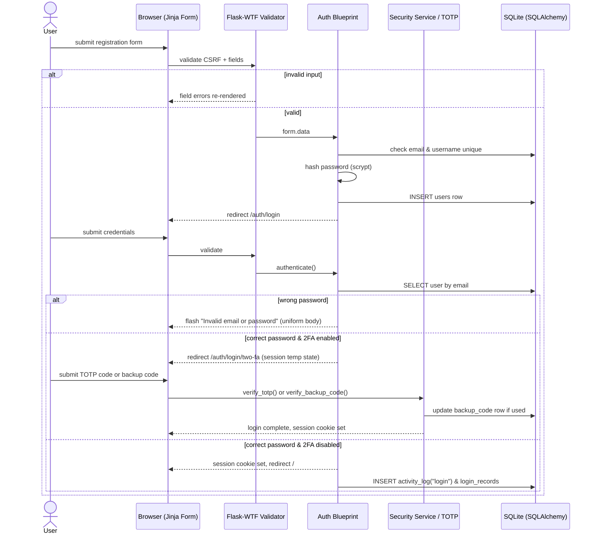
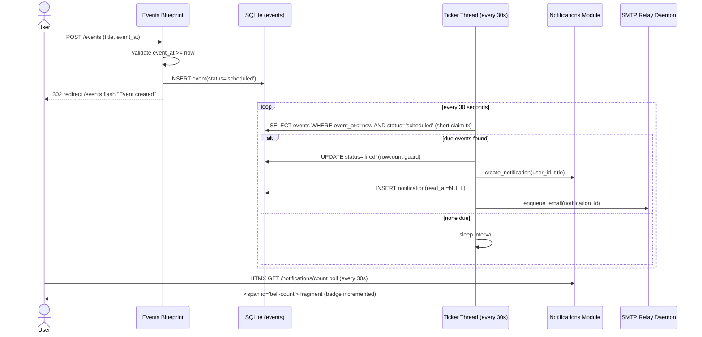
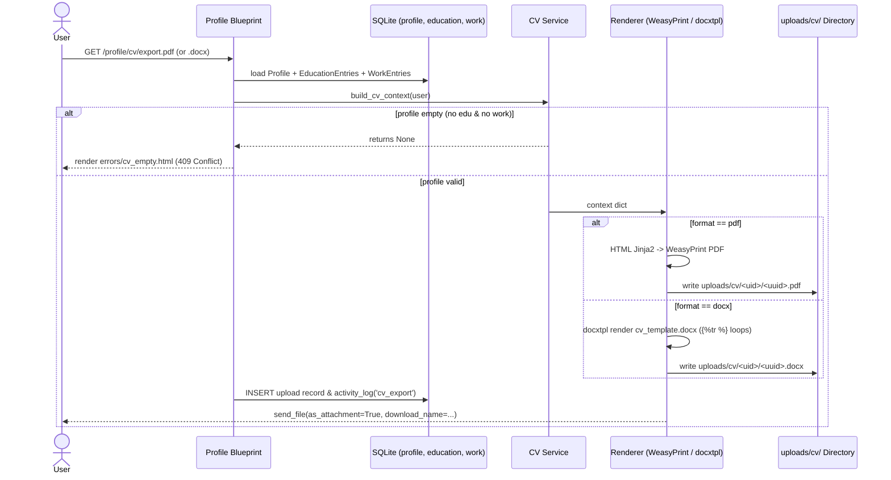

# Sequence Diagrams — Saathi ("Here I Am")

## C1 — Authentication & Session Flow (Register / Login / TOTP)

## C2 — Create Reminder → Scheduler Tick → Notification Fire

## C3 — Generate & Export Profile CV (PDF / DOCX)

